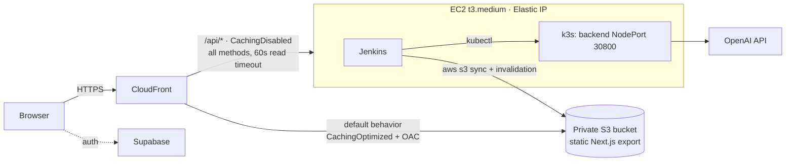

# Screenshot → Code

Upload a screenshot and OpenAI (gpt-6-luna) streams back HTML, React or Vue + Tailwind code with a live preview. Then ask it to change the code in plain English.

This repo is also a small end-to-end DevOps project: a static frontend on S3 + CloudFront, a containerised API on k3s, a Jenkins pipeline with security scanning and automatic rollback, and all of the AWS infrastructure in Terraform. It runs for under $10 a week.

| Layer | Tech |
|---|---|
| Frontend | Next.js 15 (static export), TypeScript, Tailwind v4, Supabase auth (PKCE) |
| Backend | FastAPI, OpenAI streaming, non-root multi-stage Docker image |
| Hosting | S3 (private, OAC) + CloudFront · k3s on one EC2 instance |
| CI/CD | Jenkins: lint/test → Trivy → build → push → deploy → smoke test → rollback |
| IaC / Ops | Terraform, CloudWatch agent + alarms, SSM Session Manager, AWS Budget |

## Architecture



- **Same origin for everything.** The browser calls relative `/api/...` URLs, so there's no CORS.
- The backend NodePort only accepts traffic from the AWS-managed prefix list `com.amazonaws.global.cloudfront.origin-facing`. The bucket can only be read by this distribution.
- A CloudFront Function maps `/studio/` and `/studio` to `/studio/index.html`, because S3 REST origins don't serve index files for sub-paths.
- Jenkins uses the instance role. The IAM role allows only `s3:ListBucket`, `PutObject` and `DeleteObject` on this bucket, plus `CreateInvalidation` and `GetInvalidation` on this distribution. There are no AWS keys in Jenkins.

## Run locally

```bash
cp .env.example .env          # OPENAI_API_KEY + Supabase values
docker compose up --build     # http://localhost:3000
```

The frontend container serves the same static export that goes to S3, using nginx, and proxies `/api` to the backend with buffering off. This mirrors CloudFront.

Without Docker: `cd backend && pip install -r requirements.txt && uvicorn app.main:app --reload`, then `cd frontend && npm install && npm run dev`. `next dev` rewrites `/api/*` to `BACKEND_URL`, which defaults to `http://localhost:8000`.

## Deploy to AWS

```bash
cd terraform
cp example.tfvars terraform.tfvars    # set my_ip_cidr to your IP/32
terraform init && terraform apply
terraform output                      # cloudfront_url, jenkins_url, bucket_name, distribution_id
```

Bootstrapping takes about 5–8 minutes (`user_data.sh` installs Docker, Jenkins, k3s, Trivy, Node 22, AWS CLI v2 and the CloudWatch agent).

### Jenkins

1. Open `jenkins_url`. Get the unlock password over SSM:
   `aws ssm start-session --target <instance-id>` → `sudo cat /var/lib/jenkins/secrets/initialAdminPassword`. Install the suggested plugins.
2. Add these credentials under **Manage Jenkins → Credentials**:

   | ID | Kind | Value |
   |---|---|---|
   | `openai-api-key` | Secret text | OpenAI API key |
   | `supabase-url` | Secret text | `https://<project>.supabase.co` |
   | `supabase-publishable-key` | Secret text | Supabase publishable key |

3. Create a **Pipeline** job → *Pipeline script from SCM* → this repo, branch `main`, path `Jenkinsfile`. Optionally add a GitHub webhook to `http://<jenkins>/github-webhook/`.
4. Click **Build Now**.

### Supabase

In **Authentication → URL Configuration**, set the **Site URL** to `https://<cloudfront-domain>` and add `https://<cloudfront-domain>/auth/callback` to **Redirect URLs**.

### Pipeline

| Stage | What it does |
|---|---|
| Lint & Test (parallel) | Backend: `ruff` + `pytest`. Frontend: `tsc --noEmit` |
| Trivy FS scan | Vulnerabilities and secrets in the repo (report archived) |
| Backend | `docker build` → Trivy image scan (fails on CRITICAL) → push `:$BUILD_NUMBER` → `kubectl apply` → `rollout status` → `curl /api/health` |
| Frontend | `npm ci && npm run build` with the Supabase values from credentials → S3 sync in 2 passes (hashed assets `immutable`, HTML `no-cache`) → CloudFront invalidation `/*` and wait |
| E2E smoke test | `GET /` = 200 and `GET /api/health` = ok through CloudFront, with retries |
| On failure | `kubectl rollout undo deploy/backend` |
| Always | Archive the Trivy reports and prune Docker images |

The bucket and distribution are found at runtime by the distribution's Comment (`ss-to-code`). Nothing is hardcoded.

## Rollback

- **Backend:** this is automatic on failure. To roll back by hand: `kubectl -n ss-to-code rollout undo deploy/backend`. Images are tagged `$BUILD_NUMBER` and kept in k3s, so `rollout undo` has the previous image locally.
- **Frontend:** use *Rebuild* on the last good Jenkins build, or restore the previous object versions (bucket versioning is on and keeps old versions for 14 days), then run
  `aws cloudfront create-invalidation --distribution-id <id> --paths "/*"`.

## Cost (ap-southeast-1)

| Item | ~ per week |
|---|---|
| EC2 t3.medium, 24/7 | $8.20 |
| EBS gp3, 30 GB | $0.60 |
| Elastic IP (public IPv4) | $0.84 |
| CloudFront + S3 | $0 (free tier) |
| CloudWatch (3-day log retention) | ~$0 |
| **Total** | **~$9.60 / week, ~$4 for 3 days** |

Stop the instance when you're not using it (`aws ec2 stop-instances`). The Elastic IP keeps the CloudFront origin stable across stop/start. Terraform also creates a `$10` AWS Budget.

## Teardown

```bash
./scripts/teardown.sh
```

This empties the versioned bucket (all object versions), runs `terraform destroy`, and then lists any `Project=ss-to-code` resources that are still around. The Docker Hub images aren't AWS resources, so delete those yourself if you want.
