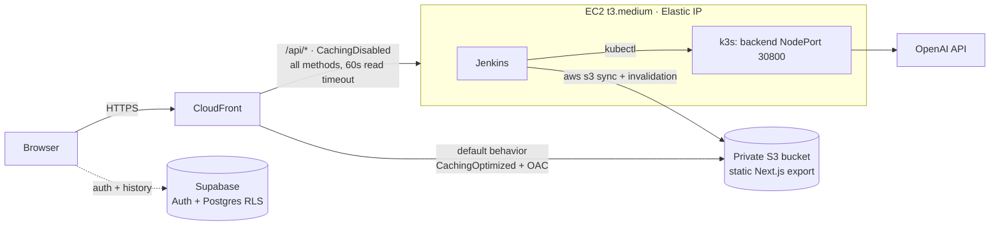
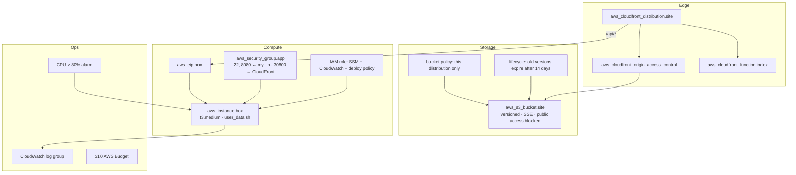
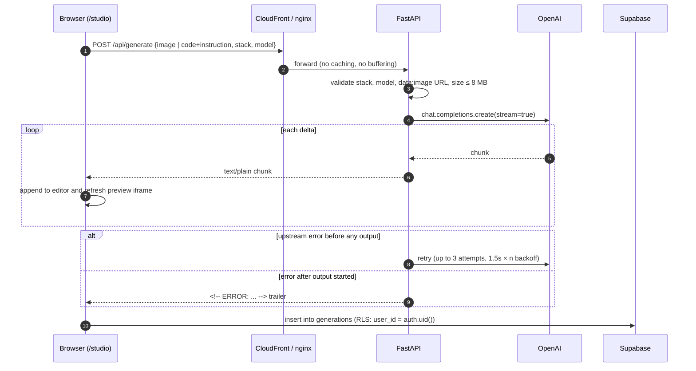
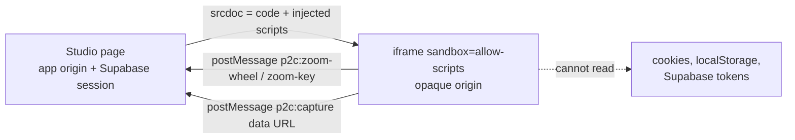
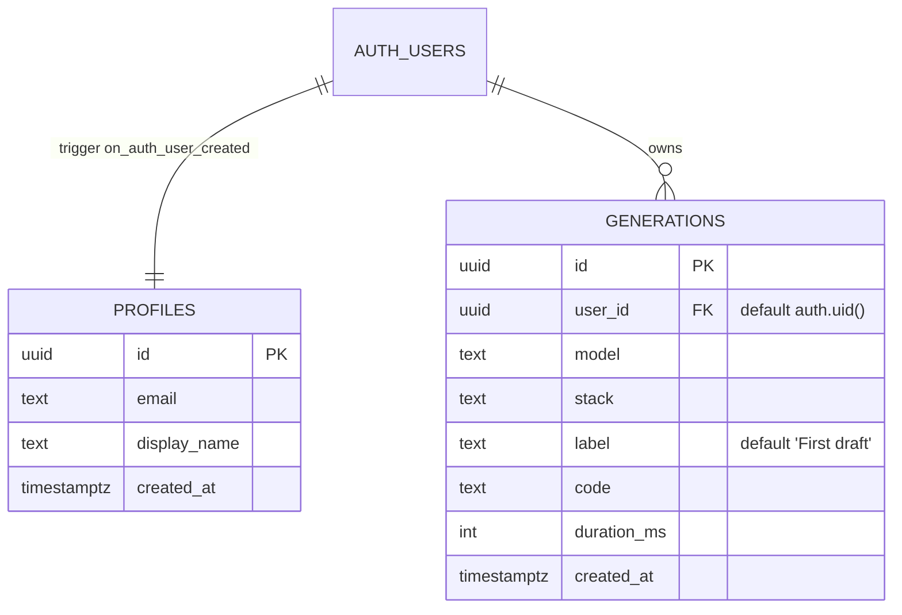
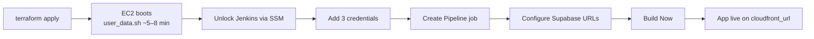
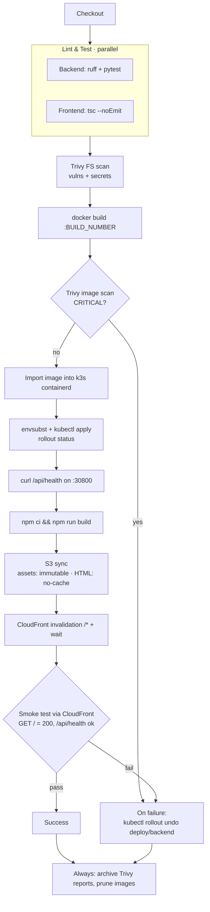

# Screenshot → Code

Upload a screenshot and OpenAI (default `gpt-6-luna`) streams back a single-file HTML, React or Vue page, styled with Tailwind or plain CSS, with a live preview. Then ask for changes in plain English, export the result as code or as an image, and keep a per-user history in Supabase.

This repo is also a small end-to-end DevOps project: a static frontend on S3 + CloudFront, a containerised API on k3s, a Jenkins pipeline with security scanning and automatic rollback, and all of the AWS infrastructure in Terraform. It runs for under $10 a week.

---

## Contents

- [Features](#features)
- [Tech stack](#tech-stack)
- [Repository layout](#repository-layout)
- [Architecture](#architecture)
- [How a generation works](#how-a-generation-works)
- [Authentication and data](#authentication-and-data)
- [Backend API](#backend-api)
- [Configuration](#configuration)
- [Run locally](#run-locally)
- [Testing](#testing)
- [Deploy to AWS](#deploy-to-aws)
- [CI/CD pipeline](#cicd-pipeline)
- [Security model](#security-model)
- [Observability](#observability)
- [Rollback](#rollback)
- [Cost](#cost-ap-southeast-1)
- [Teardown](#teardown)
- [Troubleshooting](#troubleshooting)

---

## Features

- **Screenshot to code, streamed.** Code shows up token by token while the model writes it.
- **Six output stacks:** `html_tailwind`, `react_tailwind`, `vue_tailwind`, `html_css`, `react_css`, `vue_css`. Each one is a single self-contained HTML file that loads its libraries from a CDN, so it opens straight in a browser.
- **Model picker.** The backend publishes an allow-list of models (`/api/models`), and the request is rejected if the model isn't on it.
- **Edit by chatting.** Send the current code and an instruction, and the model returns the full updated file.
- **Sandboxed live preview.** Generated code runs in an `<iframe sandbox="allow-scripts">` with no `allow-same-origin`, so it can't reach the app's origin, cookies or Supabase session. Ctrl/⌘ + wheel and Ctrl/⌘ +/-/0 inside the preview are forwarded to the studio's zoom through `postMessage`.
- **Export.** Copy to the clipboard, download as `.html`, or render a PNG/JPEG at preset sizes with `html-to-image`, which also runs inside the sandbox.
- **History.** Each generation (model, stack, label, code, duration) is saved to Supabase and protected by Row Level Security.
- **Speedrun timer.** Personal-best splits per model are kept in `localStorage`.

## Tech stack

| Layer | Tech |
|---|---|
| Frontend | Next.js 15 (static export), React 19, TypeScript, Tailwind v4, Supabase auth (PKCE) |
| Backend | Python 3.12, FastAPI, OpenAI async streaming, non-root multi-stage Docker image |
| Data / auth | Supabase Postgres with RLS, Supabase Auth |
| Hosting | S3 (private, OAC) + CloudFront · k3s on one EC2 instance |
| CI/CD | Jenkins: lint/test → Trivy → build → load into k3s → deploy → smoke test → rollback |
| IaC / Ops | Terraform, CloudWatch agent + alarms, SSM Session Manager, AWS Budget |

## Repository layout

```text
ss-to-code/
├── backend/                  FastAPI service
│   ├── app/main.py           routes, validation, OpenAI streaming + retry
│   ├── app/prompts.py        stack definitions and system/update prompts
│   ├── tests/test_api.py     pytest API tests
│   └── Dockerfile            python:3.12-slim, runs as uid 10001
├── frontend/                 Next.js app (output: static export)
│   ├── app/                  /, /login, /auth/callback, /reset-password, /studio
│   ├── components/           export modal, speedrun timer, demo, illustrations
│   ├── lib/preview.ts        scripts injected into the sandboxed preview (zoom, capture)
│   ├── lib/supabase/         browser Supabase client
│   ├── nginx.conf            local parity: serves the export, proxies /api
│   └── Dockerfile            node:22 build → nginx-unprivileged
├── supabase/migrations/      profiles + generations tables, RLS, signup trigger
├── k8s/app.yaml              Namespace, Deployment, NodePort Service
├── terraform/                VPC-default EC2, S3, CloudFront, IAM, alarms, budget
├── scripts/teardown.sh       empty the bucket, destroy, list leftovers
├── Jenkinsfile               CI/CD pipeline
└── docker-compose.yml        local stack
```

## Architecture



- **One origin for everything.** The browser calls relative `/api/...` URLs, so there's no CORS. The same pattern holds in every environment:

  | Environment | Who serves the frontend | Who routes `/api/*` to the backend |
  |---|---|---|
  | `next dev` | Next.js dev server | Next rewrite to `BACKEND_URL` (default `http://localhost:8000`) |
  | `docker compose` | nginx (port 3000) | nginx `proxy_pass`, `proxy_buffering off` |
  | AWS | CloudFront → S3 | CloudFront `/api/*` behavior → EC2:30800 |

- The backend NodePort only accepts traffic from the AWS-managed prefix list `com.amazonaws.global.cloudfront.origin-facing`. The bucket can only be read by this distribution (Origin Access Control).
- A CloudFront Function maps `/studio/` and `/studio` to `/studio/index.html`, because S3 REST origins don't serve index files for sub-paths.
- Jenkins uses the instance role. That role allows only `s3:ListBucket`, `PutObject` and `DeleteObject` on this bucket, plus `CreateInvalidation` and `GetInvalidation` on this distribution. There are no AWS keys in Jenkins.

### AWS resources (Terraform)



## How a generation works



Notes:

- The response is `text/plain` with `X-Accel-Buffering: no` and `Cache-Control: no-cache`, so proxies pass chunks through right away.
- Retries only happen before the first byte reaches the client. After that a retry would duplicate output, so the stream ends with an `<!-- ERROR: ... -->` comment, which the studio turns into an error message.
- The prompt (`backend/app/prompts.py`) asks for pixel-accurate layout, complete content with no placeholders, `placehold.co` images, Font Awesome icons, and raw code with no markdown fences.

### Preview sandbox



`lib/preview.ts` injects two helpers before `</body>`: a zoom bridge, and a capture script that loads `html-to-image`, renders the page to a canvas, and posts back a data URL. `html-to-image` is used instead of `html2canvas` because it works without `allow-same-origin`.

## Authentication and data

Supabase Auth runs in the browser with the PKCE flow. `/auth/callback` exchanges the code for a session, and `/reset-password` handles recovery links.



- RLS is on for both tables. Users can read and update only their own profile, and select, insert or delete only their own generations.
- `handle_new_user()` (security definer, empty `search_path`) creates the profile row on sign-up, with `display_name` taken from the user metadata or the email local part.
- Index: `generations (user_id, created_at desc)`.

Apply the migration with the Supabase CLI (`supabase db push`) or paste `supabase/migrations/0001_init.sql` into the SQL editor.

## Backend API

| Method | Path | Description |
|---|---|---|
| GET | `/health`, `/api/health` | `{"status":"ok","version":"<APP_VERSION>"}`. Used by k8s probes and the smoke test |
| GET | `/api/stacks` | List of stack ids |
| GET | `/api/models` | `{"default": "...", "models": [...]}` |
| POST | `/api/generate` | Streams generated code as `text/plain` |

`POST /api/generate` body:

```jsonc
{
  "image": "data:image/png;base64,...", // for a new generation
  "stack": "html_tailwind",             // one of /api/stacks
  "code": "<html>...</html>",           // for an edit, together with instruction
  "instruction": "make the header sticky",
  "model": "gpt-6-luna"                 // optional, must be in /api/models
}
```

| Status | When |
|---|---|
| 400 | Unknown stack, model not enabled, image isn't a `data:image/` URL, or neither image nor code+instruction given |
| 413 | Decoded image is larger than `MAX_IMAGE_BYTES` |
| 503 | `OPENAI_API_KEY` is not set |

Example:

```bash
curl -N http://localhost:8000/api/generate \
  -H 'content-type: application/json' \
  -d '{"stack":"html_tailwind","code":"<html><body>hi</body></html>","instruction":"center the text"}'
```

## Configuration

| Variable | Used by | Default | Purpose |
|---|---|---|---|
| `OPENAI_API_KEY` | backend | — | Required for generation |
| `OPENAI_MODEL` | backend | `gpt-6-luna` | Default model, always allowed |
| `OPENAI_MODELS` | backend | `gpt-6-luna,gpt-6-sol,gpt-6-astra,gpt-5.5,gpt-5.4-mini` | Allow-list shown in the picker |
| `MAX_IMAGE_BYTES` | backend | `8388608` | Upload size limit |
| `LOG_LEVEL` | backend | `INFO` | Python logging level |
| `APP_VERSION` | backend | `dev` | Shown by `/health`. k8s sets it to the build number |
| `NEXT_PUBLIC_SUPABASE_URL` | frontend (build time) | — | Supabase project URL |
| `NEXT_PUBLIC_SUPABASE_PUBLISHABLE_KEY` | frontend (build time) | — | Supabase publishable key |
| `BACKEND_URL` | `next dev` only | `http://localhost:8000` | Target of the `/api/*` rewrite |

The `NEXT_PUBLIC_*` values are baked into the static export, so changing them means rebuilding the frontend.

## Run locally

```bash
cp .env.example .env          # OPENAI_API_KEY + Supabase values
docker compose up --build     # http://localhost:3000  (API also on :8000)
```

The frontend container serves the same static export that goes to S3, using nginx, and proxies `/api` to the backend with buffering off and a 300 s read timeout. This mirrors CloudFront.

Without Docker:

```bash
# terminal 1
cd backend && python -m venv .venv && . .venv/bin/activate
pip install -r requirements.txt && uvicorn app.main:app --reload

# terminal 2
cd frontend && npm install && npm run dev   # http://localhost:3000
```

For sign-in to work locally, add `http://localhost:3000/auth/callback` to the Supabase redirect URLs.

## Testing

```bash
cd backend && ruff check app && python -m pytest -q
cd frontend && npm run lint     # tsc --noEmit
```

The backend tests cover health, the stack and model lists, and rejection of an unknown stack, an unknown model, and a request with no input. They don't call OpenAI.

## Deploy to AWS



```bash
cd terraform
cp example.tfvars terraform.tfvars    # set my_ip_cidr to your IP/32
terraform init && terraform apply
terraform output                      # cloudfront_url, jenkins_url, bucket_name, distribution_id, public_ip, ssm
```

Terraform variables:

| Variable | Default | Notes |
|---|---|---|
| `region` | `ap-southeast-1` | The Jenkinsfile also uses this region |
| `instance_type` | `t3.medium` | k3s + Jenkins + builds need about 4 GB of RAM |
| `my_ip_cidr` | — (required) | Allowed to reach SSH (22) and Jenkins (8080) |
| `key_name` | `""` | Optional. SSM works without a key pair |
| `backend_node_port` | `30800` | Must match `nodePort` in `k8s/app.yaml` |

`user_data.sh` installs Docker, Jenkins, k3s, Trivy, Node 22, AWS CLI v2 and the CloudWatch agent, and gives Jenkins a kubeconfig.

### Jenkins

1. Open `jenkins_url`. Get the unlock password over SSM:
   `aws ssm start-session --target <instance-id>` → `sudo cat /var/lib/jenkins/secrets/initialAdminPassword`. Install the suggested plugins.
2. Add these credentials under **Manage Jenkins → Credentials**:

   | ID | Kind | Value |
   |---|---|---|
   | `openai-api-key` | Secret text | OpenAI API key |
   | `supabase-url` | Secret text | `https://<project>.supabase.co` |
   | `supabase-publishable-key` | Secret text | Supabase publishable key |

3. Create a **Pipeline** job → *Pipeline script from SCM* → this repo, branch `main`, path `Jenkinsfile`. Optionally add a GitHub webhook to `http://<jenkins>/github-webhook/`.
4. Click **Build Now**.

### Supabase

In **Authentication → URL Configuration**, set the **Site URL** to `https://<cloudfront-domain>` and add `https://<cloudfront-domain>/auth/callback` to **Redirect URLs**. Run the migration in `supabase/migrations/`.

## CI/CD pipeline



| Stage | What it does |
|---|---|
| Lint & Test (parallel) | Backend: `ruff` + `pytest`. Frontend: `tsc --noEmit` |
| Trivy FS scan | Vulnerabilities and secrets in the repo (report archived) |
| Backend | `docker build` → Trivy image scan (fails on CRITICAL) → import `:$BUILD_NUMBER` into k3s (single node, no registry) → `kubectl apply` → `rollout status` → `curl /api/health` |
| Frontend | `npm ci && npm run build` with the Supabase values from credentials → S3 sync in 2 passes (hashed assets `immutable`, HTML `no-cache`) → CloudFront invalidation `/*` and wait |
| E2E smoke test | `GET /` = 200 and `GET /api/health` = ok through CloudFront, with retries |
| On failure | `kubectl rollout undo deploy/backend` |
| Always | Archive the Trivy reports and prune Docker images |

Pipeline options: 40-minute timeout, last 10 builds kept, no concurrent builds, timestamps on. The bucket and distribution are found at runtime by the distribution's Comment (`ss-to-code`). Nothing is hardcoded.

### Kubernetes

`k8s/app.yaml` defines the `ss-to-code` namespace, a one-replica `backend` Deployment (`imagePullPolicy: Never`, `revisionHistoryLimit: 5`, requests 50m/128Mi, limits 500m/384Mi, readiness and liveness probes on `/health`) and a NodePort Service on 30800. `OPENAI_API_KEY` comes from the `openai` Secret, which Jenkins creates from its credential.

## Security model

| Concern | Control |
|---|---|
| Generated code running in the app | Sandboxed iframe, `allow-scripts` only, opaque origin |
| Direct access to the API | Security group allows NodePort 30800 only from the CloudFront origin-facing prefix list |
| Direct access to the bucket | Public access blocked, SSE, bucket policy limited to this distribution via OAC |
| Admin access | Jenkins (8080) and SSH (22) limited to `my_ip_cidr`. SSM Session Manager for shell access |
| CI credentials | No AWS keys. Instance role scoped to one bucket and one distribution. App secrets kept in Jenkins credentials |
| Supply chain | Trivy scans the repo and the image. The build fails on CRITICAL findings |
| Containers | Backend runs as uid 10001. Frontend runs on `nginx-unprivileged` |
| User data | Supabase RLS on every table |
| Abuse limits | Model allow-list, 8 MB image limit, `max_completion_tokens=16000` |

## Observability

- Backend logs one line per generation: model, stack and duration.
- The CloudWatch agent ships instance logs to a log group with 3-day retention.
- A CloudWatch alarm fires when CPU is above 80%.
- An AWS Budget of $10 warns about spend.
- `kubectl -n ss-to-code logs deploy/backend -f` for live logs (over SSM).

## Rollback

- **Backend:** this is automatic on failure. To roll back by hand: `kubectl -n ss-to-code rollout undo deploy/backend`. Images are tagged `$BUILD_NUMBER` and kept in k3s, so `rollout undo` has the previous image locally.
- **Frontend:** use *Rebuild* on the last good Jenkins build, or restore the previous object versions (bucket versioning is on and keeps old versions for 14 days), then run
  `aws cloudfront create-invalidation --distribution-id <id> --paths "/*"`.

## Cost (ap-southeast-1)

| Item | ~ per week |
|---|---|
| EC2 t3.medium, 24/7 | $8.20 |
| EBS gp3, 30 GB | $0.60 |
| Elastic IP (public IPv4) | $0.84 |
| CloudFront + S3 | $0 (free tier) |
| CloudWatch (3-day log retention) | ~$0 |
| **Total** | **~$9.60 / week, ~$4 for 3 days** |

OpenAI usage is billed separately. Stop the instance when you're not using it (`aws ec2 stop-instances`). The Elastic IP keeps the CloudFront origin stable across stop/start. Terraform also creates a `$10` AWS Budget.

## Teardown

```bash
./scripts/teardown.sh
```

This empties the versioned bucket (all object versions), runs `terraform destroy`, and then lists any `Project=ss-to-code` resources that are still around.

## Troubleshooting

| Symptom | Likely cause / fix |
|---|---|
| `503 OPENAI_API_KEY is not configured` | Key missing from `.env`, or the `openai` k8s Secret wasn't created |
| Code appears all at once instead of streaming | A proxy is buffering. Check `proxy_buffering off` (nginx) or that `/api/*` uses CachingDisabled |
| `/studio` returns 403/404 on CloudFront | The CloudFront Function isn't attached to the default behavior |
| Login redirects to the wrong host | Supabase Site URL / Redirect URLs don't match the CloudFront domain |
| CloudFront `/api/*` returns 504 | Backend pod not ready (`kubectl -n ss-to-code get pods`) or the security group prefix list is missing |
| Jenkins unreachable | Your IP changed. Update `my_ip_cidr` and re-apply |
| Image export says "Could not load the renderer" | The preview couldn't load `html-to-image` from jsDelivr (offline or blocked) |
