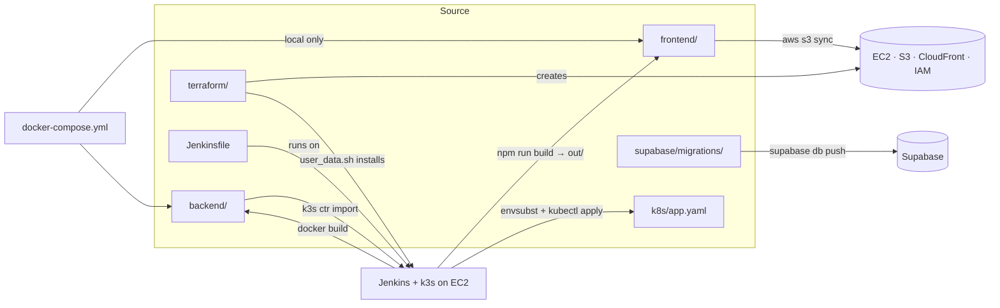
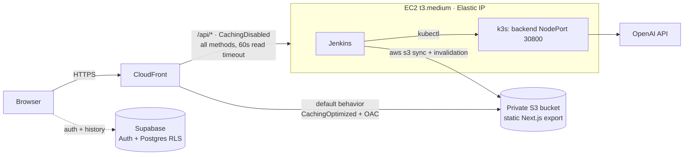
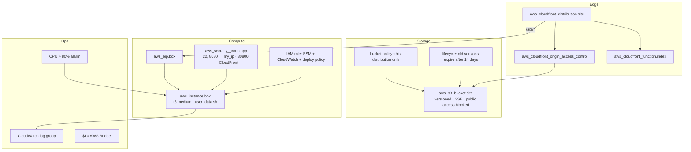
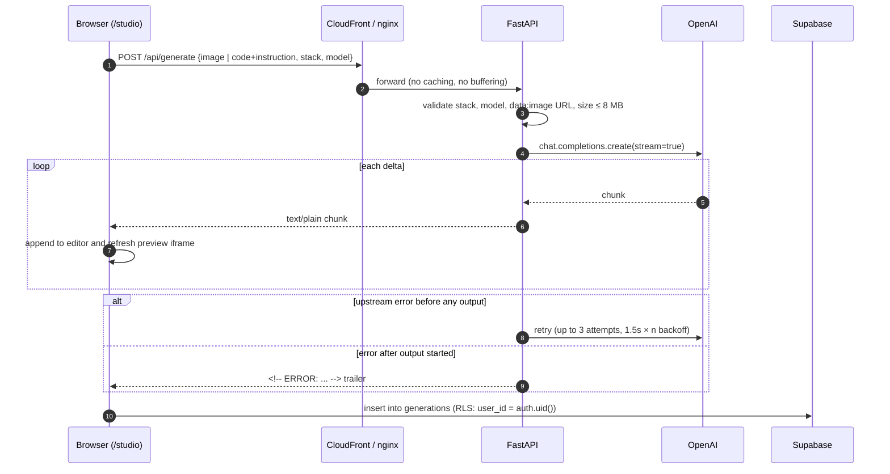
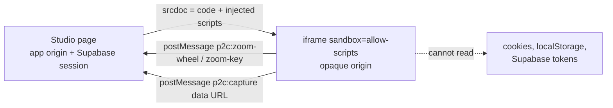
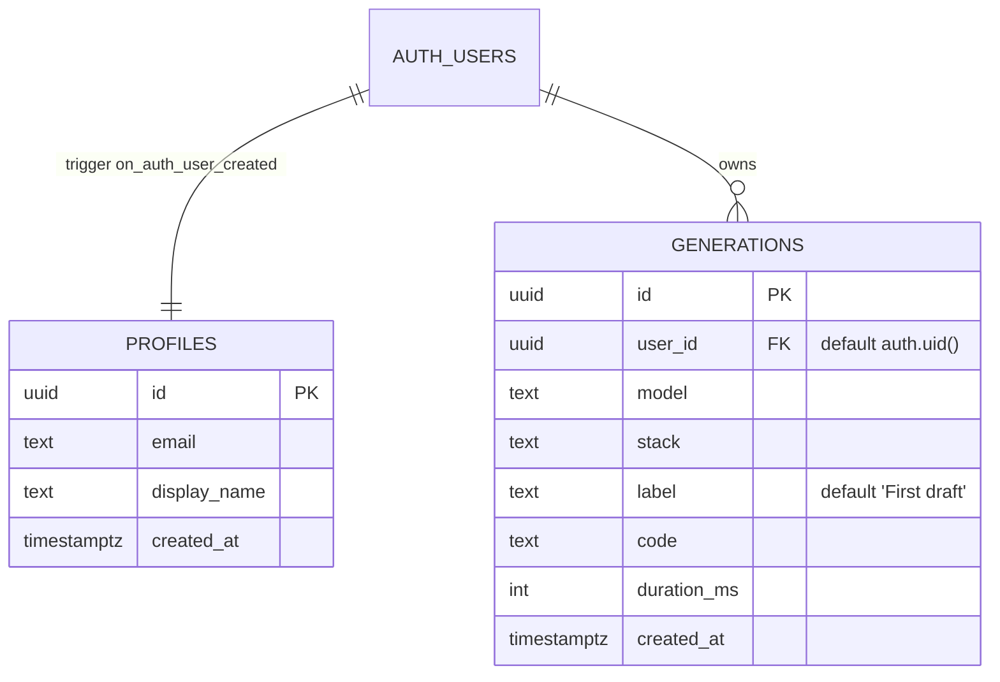
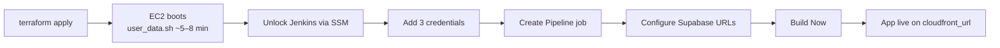
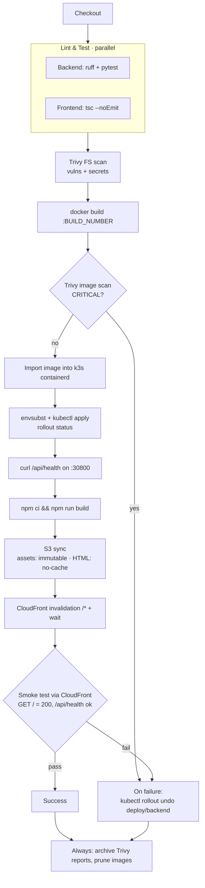

# Screenshot → Code

Upload a screenshot and OpenAI (default `gpt-6-luna`) streams back a single-file HTML, React or Vue page, styled with Tailwind or plain CSS, with a live preview. Then ask for changes in plain English, export the result as code or as an image, and keep a per-user history in Supabase.

This repo is also a small end-to-end DevOps project: a static frontend on S3 + CloudFront, a containerised API on k3s, a Jenkins pipeline with security scanning and automatic rollback, and all of the AWS infrastructure in Terraform. It runs for under $10 a week.

---

## Contents

- [Features](#features)
- [Tech stack](#tech-stack)
- [Working tree](#working-tree)
- [Architecture](#architecture)
- [Design decisions: why, and why not](#design-decisions-why-and-why-not)
- [How a generation works](#how-a-generation-works)
- [Authentication and data](#authentication-and-data)
- [Backend API](#backend-api)
- [Configuration](#configuration)
- [Run locally](#run-locally)
- [Testing](#testing)
- [Deploy to AWS](#deploy-to-aws)
- [CI/CD pipeline](#cicd-pipeline)
- [Security model](#security-model)
- [Observability](#observability)
- [Rollback](#rollback)
- [Cost](#cost-ap-southeast-1)
- [Teardown](#teardown)
- [Troubleshooting](#troubleshooting)

---

## Features

- **Screenshot to code, streamed.** Code shows up token by token while the model writes it.
- **Six output stacks:** `html_tailwind`, `react_tailwind`, `vue_tailwind`, `html_css`, `react_css`, `vue_css`. Each one is a single self-contained HTML file that loads its libraries from a CDN, so it opens straight in a browser.
- **Model picker.** The backend publishes an allow-list of models (`/api/models`), and the request is rejected if the model isn't on it.
- **Edit by chatting.** Send the current code and an instruction, and the model returns the full updated file.
- **Sandboxed live preview.** Generated code runs in an `<iframe sandbox="allow-scripts">` with no `allow-same-origin`, so it can't reach the app's origin, cookies or Supabase session. Ctrl/⌘ + wheel and Ctrl/⌘ +/-/0 inside the preview are forwarded to the studio's zoom through `postMessage`.
- **Export.** Copy to the clipboard, download as `.html`, or render a PNG/JPEG at preset sizes with `html-to-image`, which also runs inside the sandbox.
- **History.** Each generation (model, stack, label, code, duration) is saved to Supabase and protected by Row Level Security.
- **Speedrun timer.** Personal-best splits per model are kept in `localStorage`.

## Tech stack

| Layer | Tech |
|---|---|
| Frontend | Next.js 15 (static export), React 19, TypeScript, Tailwind v4, Supabase auth (PKCE) |
| Backend | Python 3.12, FastAPI, OpenAI async streaming, non-root multi-stage Docker image |
| Data / auth | Supabase Postgres with RLS, Supabase Auth |
| Hosting | S3 (private, OAC) + CloudFront · k3s on one EC2 instance |
| CI/CD | Jenkins: lint/test → Trivy → build → load into k3s → deploy → smoke test → rollback |
| IaC / Ops | Terraform, CloudWatch agent + alarms, SSM Session Manager, AWS Budget |

## Working tree

Every tracked file, what it does, and where it fits in the system.

```text
ss-to-code/
├── .env.example                 template for local secrets (OpenAI key, model list, Supabase)
├── .gitignore
├── docker-compose.yml           local stack: backend :8000 + nginx frontend :3000
├── Jenkinsfile                  the whole CI/CD pipeline
├── README.md
│
├── backend/                     ── the API (Python 3.12 / FastAPI) ──
│   ├── app/
│   │   ├── __init__.py
│   │   ├── main.py              routes, validation, model allow-list, OpenAI streaming + retries
│   │   └── prompts.py           STACKS dict, SYSTEM_PROMPT, UPDATE_PROMPT, build_messages()
│   ├── tests/test_api.py        pytest with FastAPI TestClient (no OpenAI calls)
│   ├── requirements.txt         pinned fastapi, uvicorn, openai, pydantic, httpx, pytest, ruff
│   ├── Dockerfile               python:3.12-slim, non-root uid 10001, HEALTHCHECK on /health
│   └── .dockerignore
│
├── frontend/                    ── the web app (Next.js 15, static export) ──
│   ├── app/                     App Router pages, each exported to <route>/index.html
│   │   ├── layout.tsx           root layout, fonts, global CSS
│   │   ├── globals.css          Tailwind v4 entry + theme tokens
│   │   ├── page.tsx             landing page (features, demo)
│   │   ├── loading.tsx, error.tsx
│   │   ├── login/page.tsx       sign in / sign up / forgot password
│   │   ├── auth/callback/page.tsx   exchangeCodeForSession (PKCE) after email links
│   │   ├── reset-password/page.tsx  updateUser({ password })
│   │   └── studio/
│   │       ├── layout.tsx       studio shell
│   │       └── page.tsx         upload, stack/model pickers, streaming editor, preview, history
│   ├── components/
│   │   ├── export-modal.tsx     PNG/JPEG export at preset sizes via the capture script
│   │   ├── speedrun.tsx         generation timer with per-model personal bests (localStorage)
│   │   ├── demo.tsx             animated demo on the landing page
│   │   ├── auth-shell.tsx, modal.tsx, logo.tsx, illustrations.tsx
│   ├── lib/
│   │   ├── preview.ts           scripts injected into the sandboxed iframe (zoom bridge, capture)
│   │   └── supabase/client.ts   browser Supabase client
│   ├── next.config.ts           dev: /api rewrite · build: output "export", trailingSlash
│   ├── nginx.conf               local parity with CloudFront: static files + /api proxy, no buffering
│   ├── Dockerfile               node:22-alpine build → nginx-unprivileged
│   ├── package.json, package-lock.json, tsconfig.json, postcss.config.mjs, next-env.d.ts
│   └── .dockerignore
│
├── supabase/migrations/
│   └── 0001_init.sql            profiles + generations, RLS policies, on-signup trigger
│
├── k8s/
│   └── app.yaml                 Namespace, Deployment (1 replica, probes, limits), NodePort 30800
│
├── terraform/                   ── all AWS infrastructure ──
│   ├── main.tf                  provider, Ubuntu 24.04 AMI, security group, IAM role, EC2, logs, CPU alarm
│   ├── frontend.tf              Elastic IP, S3 bucket (+ policy, versioning, lifecycle), OAC,
│   │                            CloudFront Function, distribution, deploy IAM policy, Budget
│   ├── variables.tf             region, instance_type, key_name, my_ip_cidr, backend_node_port
│   ├── outputs.tf               cloudfront_url, bucket_name, distribution_id, public_ip, jenkins_url, ssm
│   ├── user_data.sh             first-boot: Docker, Jenkins, k3s, Trivy, Node 22, AWS CLI, CW agent
│   ├── example.tfvars
│   └── .terraform.lock.hcl      pinned provider versions
│
└── scripts/
    └── teardown.sh              empty versioned bucket → terraform destroy → list leftovers by tag
```

### How the pieces relate



**Who owns what at runtime**

| Concern | Lives in | Changed by |
|---|---|---|
| Prompts and output formats | `backend/app/prompts.py` | Backend deploy (Jenkins) |
| Allowed models | `OPENAI_MODEL(S)` env | `.env` locally; the default in `main.py` on AWS |
| UI, routing, auth flow | `frontend/app/**` | Frontend deploy (S3 sync + invalidation) |
| Preview isolation | `frontend/lib/preview.ts` + iframe `sandbox` in `studio/page.tsx` | Frontend deploy |
| Database schema and access rules | `supabase/migrations/` | Applied by hand with the Supabase CLI |
| Pod spec, port, resources | `k8s/app.yaml` | Every pipeline run (`kubectl apply`) |
| Network, IAM, CDN, budget | `terraform/` | `terraform apply` by hand (not in CI) |

## Architecture



- **One origin for everything.** The browser calls relative `/api/...` URLs, so there's no CORS. The same pattern holds in every environment:

  | Environment | Who serves the frontend | Who routes `/api/*` to the backend |
  |---|---|---|
  | `next dev` | Next.js dev server | Next rewrite to `BACKEND_URL` (default `http://localhost:8000`) |
  | `docker compose` | nginx (port 3000) | nginx `proxy_pass`, `proxy_buffering off` |
  | AWS | CloudFront → S3 | CloudFront `/api/*` behavior → EC2:30800 |

- The backend NodePort only accepts traffic from the AWS-managed prefix list `com.amazonaws.global.cloudfront.origin-facing`. The bucket can only be read by this distribution (Origin Access Control).
- A CloudFront Function maps `/studio/` and `/studio` to `/studio/index.html`, because S3 REST origins don't serve index files for sub-paths.
- Jenkins uses the instance role. That role allows only `s3:ListBucket`, `PutObject` and `DeleteObject` on this bucket, plus `CreateInvalidation` and `GetInvalidation` on this distribution. There are no AWS keys in Jenkins.

### AWS resources (Terraform)



## Design decisions: why, and why not

The project has two goals that pull against each other: show a realistic production-style setup (CDN, containers, orchestration, IaC, CI/CD with security gates and rollback), and keep the bill under about $10 a week. Most choices below come from that tension.

### 1. Static export on S3 + CloudFront, not a Next.js server

**Why**
- Every page is client-rendered after login anyway: the studio talks to `/api` and Supabase from the browser. A Node server would only be serving HTML.
- S3 + CloudFront is close to free at this scale, has no process to keep alive, and scales by itself.
- The backend box only has to handle API traffic, which matters on a single t3.medium.

**Why not the alternatives**
| Option | Reason it wasn't used |
|---|---|
| `next start` on EC2/k3s | Another long-running process competing for 4 GB RAM with Jenkins and k3s. No SSR need. |
| Vercel / Amplify | Works fine, but it hides the CDN, cache headers and invalidation, which this project is meant to show. |
| Public S3 website endpoint | Needs a public bucket and only speaks HTTP. OAC keeps the bucket private. |

**Cost of this choice:** no server components, middleware or ISR. S3 REST origins don't serve `index.html` for sub-paths, so a CloudFront Function rewrites `/studio` → `/studio/index.html` and `trailingSlash: true` is set in `next.config.ts`. Supabase values are baked in at build time.

### 2. One origin (CloudFront routes `/api/*`), not a separate API domain

**Why**
- The browser makes relative `/api/...` calls, so there's no CORS config, no preflight requests and no extra certificate or DNS.
- The backend never needs a public hostname, so the security group can allow only CloudFront's managed prefix list.
- nginx (compose) and the `next dev` rewrite copy the same routing, so the frontend code is the same everywhere.

**Why not** `api.example.com` + CORS: more moving parts (domain, cert, CORS allow-list) and an API that's reachable directly from the internet.

**Trade-off:** CloudFront's origin read timeout (60 s) applies between bytes. Streaming keeps bytes flowing, so long generations still work, but a model that stays silent for over 60 s before its first token would fail.

### 3. FastAPI backend, not calling OpenAI from the browser

**Why**
- The OpenAI key must never reach the client.
- The server enforces the model allow-list, image size limit, stack whitelist and `max_completion_tokens`, so a user can't pick an expensive model or send huge payloads.
- Async FastAPI + `AsyncOpenAI` handles many slow streaming requests on one small process.

**Why not** a serverless function (Lambda): response streaming through API Gateway is awkward, and long generations run into timeouts. It would also remove the container/Kubernetes part of the project.

### 4. Plain text streaming, not SSE or WebSockets

**Why:** the payload is one growing string. A chunked `text/plain` response read with `fetch().body.getReader()` is the simplest thing that works through CloudFront and nginx. The only extra step is turning off proxy buffering (`X-Accel-Buffering: no`, `proxy_buffering off`).

**Why not**
- **SSE:** adds event framing for no benefit. There's only one kind of message.
- **WebSockets:** CloudFront supports them, but they need connection state and don't fit a request/response flow.

**Trade-off:** errors can't use HTTP status codes once streaming has started (headers are already sent). So a mid-stream failure is sent as a trailing `<!-- ERROR: ... -->` comment, and the client checks for it.

### 5. Retry only before the first byte

The backend retries up to 3 times with growing backoff, but only while nothing has been sent. Retrying after output started would make the client see duplicated, broken code. This is the one place where "retry everything" would be wrong.

### 6. k3s on one EC2 instance, not EKS / ECS / plain Docker

**Why k3s**
- Real Kubernetes objects (Deployment, Service, Secret, probes, `rollout undo`) at the cost of one VM.
- Rollback history (`revisionHistoryLimit: 5`) comes for free.
- Traefik is disabled in `user_data.sh` because CloudFront already does routing.

| Option | Reason it wasn't used |
|---|---|
| EKS | Control plane alone is ~$17/week, more than the whole budget. |
| ECS Fargate | No Kubernetes, and per-task costs plus a load balancer. |
| `docker run` on EC2 | Works, but no declarative rollout, probes or built-in rollback. |

**Cost of this choice:** a single point of failure. One node, one replica, no high availability. If the instance stops, the API is down. This is accepted for a demo; see [What would change for production](#what-would-change-for-production).

### 7. No container registry: `docker save | k3s ctr images import`

**Why:** Jenkins builds on the same machine k3s runs on. Importing the image straight into k3s' containerd avoids running or paying for a registry and handling pull credentials. `imagePullPolicy: Never` makes sure k3s never tries to pull.

**Why not ECR / Docker Hub:** an extra service, IAM, and network round trip with no benefit on a single node. (An earlier version pushed to Docker Hub. It was removed.)

**Trade-off:** doesn't work as soon as there's a second node. Images are tagged `$BUILD_NUMBER`, so old ones stay local for `rollout undo`, and `docker image prune --filter until=24h` keeps the disk under control.

### 8. NodePort, not an Ingress or LoadBalancer Service

CloudFront is the only client. A NodePort on 30800, locked down by the security group, is enough. An Ingress controller would be a second router behind CloudFront, and a `LoadBalancer` Service would create an AWS load balancer (~$4/week) for one backend.

### 9. Jenkins on the same instance, not GitHub Actions

**Why**
- Jenkins can reach k3s and Docker locally, so deploys need no cluster credentials or AWS keys stored outside AWS. It uses the instance role.
- Showing a self-hosted Jenkins with a declarative pipeline is part of the project's goal.

**Why not GitHub Actions:** it would need AWS credentials (or OIDC setup) and a way into the private k3s API, for example a self-hosted runner, which brings back the same box.

**Trade-offs:** builds share CPU and memory with production traffic. Jenkins on port 8080 is restricted to `my_ip_cidr`. `disableConcurrentBuilds()` stops two deploys from fighting.

### 10. Trivy: block on CRITICAL in the image, report-only on the repo

- **Image scan** (`--severity CRITICAL --exit-code 1 --ignore-unfixed`) blocks the build. What ships is what matters, and only fixable criticals are blocked, so the pipeline isn't stuck on issues nobody can fix yet.
- **Filesystem scan** (vulns + secrets, HIGH/CRITICAL) runs with `--exit-code 0` and is archived. It's there for visibility, and so a dev-only dependency doesn't stop deploys.

### 11. Two-pass S3 sync with different cache headers

Next.js puts a content hash in asset filenames, so they can be cached for a year (`immutable`). HTML files keep the same names, so they're `no-cache`. A single sync would have to pick one rule for both. The `/*` invalidation then clears anything CloudFront already holds.

### 12. Look up the bucket and distribution at deploy time

The Jenkinsfile finds the distribution by its Comment (`ss-to-code`) and gets the bucket from its S3 origin. This means Terraform outputs don't need to be copied into Jenkins, and a `destroy` + `apply` (new random names) needs no pipeline change. It costs one unscoped permission, `cloudfront:ListDistributions`, which can't be limited to a resource.

### 13. Supabase for auth and history, not a self-built auth service

**Why:** Auth (email, reset links, PKCE) and Postgres with Row Level Security at no cost. The browser talks to Supabase directly, and RLS makes that safe: every query is limited to `auth.uid()`. The FastAPI backend stays stateless and doesn't need a database.

**Why not**
- **Cognito:** more setup for the same result, and no database.
- **RDS:** a database instance costs more than the whole weekly budget.
- **Saving history through the backend:** the backend would need DB credentials and JWT checks. RLS already does that job.

**Trade-off:** the `/api/generate` endpoint does not check the Supabase session. Anyone who finds the URL can call it, limited only by the model allow-list and size limits. Adding JWT checks in FastAPI is the first item for a public launch.

### 14. Sandboxed iframe without `allow-same-origin`

Generated code is untrusted: it's model output, possibly shaped by whatever was in the screenshot. With `allow-scripts` only, it runs in an opaque origin and can't read the app's cookies, `localStorage` or Supabase tokens. Communication goes only through `postMessage`.

This is why image export uses `html-to-image` inside the iframe and not `html2canvas`: `html2canvas` clones into a nested iframe, which needs `allow-same-origin`, and that would undo the isolation.

### 15. Single-file output with CDN libraries

Every stack produces one HTML file that loads React/Vue/Babel/Tailwind from a CDN. This lets the preview be a plain `srcdoc` iframe with no bundler, and the download opens in any browser. The cost is that it's not a project structure you'd ship directly (Babel in the browser, development builds). It's a starting point to copy from.

### 16. Terraform run by hand, local state

Infrastructure changes rarely and can delete things, so it isn't in the app pipeline. State is local by default. A commented-out S3 + DynamoDB backend in `main.tf` is ready for team use.

### 17. EC2 access over SSM, Elastic IP for a stable origin

SSM Session Manager means no SSH key is required (`key_name` is optional). The Elastic IP keeps the CloudFront origin address the same when the instance is stopped to save money and started again.

### What would change for production

| Today | For production |
|---|---|
| 1 EC2 node, 1 replica | EKS or a multi-node k3s cluster across AZs, 2+ replicas, PodDisruptionBudget |
| Images imported locally | ECR with immutable tags and image signing |
| Jenkins on the app box | Separate CI runners |
| `/api/generate` unauthenticated | Verify Supabase JWT in FastAPI, per-user rate limits and quotas |
| CloudFront default certificate | Custom domain with ACM certificate, AWS WAF with rate rules |
| Local Terraform state | S3 + DynamoDB remote state, plan in CI, apply on approval |
| CPU alarm only | Request metrics, error-rate and latency alarms, tracing |

## How a generation works



Notes:

- The response is `text/plain` with `X-Accel-Buffering: no` and `Cache-Control: no-cache`, so proxies pass chunks through right away.
- Retries only happen before the first byte reaches the client. After that a retry would duplicate output, so the stream ends with an `<!-- ERROR: ... -->` comment, which the studio turns into an error message.
- The prompt (`backend/app/prompts.py`) asks for pixel-accurate layout, complete content with no placeholders, `placehold.co` images, Font Awesome icons, and raw code with no markdown fences.

### Preview sandbox



`lib/preview.ts` injects two helpers before `</body>`: a zoom bridge, and a capture script that loads `html-to-image`, renders the page to a canvas, and posts back a data URL. `html-to-image` is used instead of `html2canvas` because it works without `allow-same-origin`.

## Authentication and data

Supabase Auth runs in the browser with the PKCE flow. `/auth/callback` exchanges the code for a session, and `/reset-password` handles recovery links.



- RLS is on for both tables. Users can read and update only their own profile, and select, insert or delete only their own generations.
- `handle_new_user()` (security definer, empty `search_path`) creates the profile row on sign-up, with `display_name` taken from the user metadata or the email local part.
- Index: `generations (user_id, created_at desc)`.

Apply the migration with the Supabase CLI (`supabase db push`) or paste `supabase/migrations/0001_init.sql` into the SQL editor.

## Backend API

| Method | Path | Description |
|---|---|---|
| GET | `/health`, `/api/health` | `{"status":"ok","version":"<APP_VERSION>"}`. Used by k8s probes and the smoke test |
| GET | `/api/stacks` | List of stack ids |
| GET | `/api/models` | `{"default": "...", "models": [...]}` |
| POST | `/api/generate` | Streams generated code as `text/plain` |

`POST /api/generate` body:

```jsonc
{
  "image": "data:image/png;base64,...", // for a new generation
  "stack": "html_tailwind",             // one of /api/stacks
  "code": "<html>...</html>",           // for an edit, together with instruction
  "instruction": "make the header sticky",
  "model": "gpt-6-luna"                 // optional, must be in /api/models
}
```

| Status | When |
|---|---|
| 400 | Unknown stack, model not enabled, image isn't a `data:image/` URL, or neither image nor code+instruction given |
| 413 | Decoded image is larger than `MAX_IMAGE_BYTES` |
| 503 | `OPENAI_API_KEY` is not set |

Example:

```bash
curl -N http://localhost:8000/api/generate \
  -H 'content-type: application/json' \
  -d '{"stack":"html_tailwind","code":"<html><body>hi</body></html>","instruction":"center the text"}'
```

## Configuration

| Variable | Used by | Default | Purpose |
|---|---|---|---|
| `OPENAI_API_KEY` | backend | — | Required for generation |
| `OPENAI_MODEL` | backend | `gpt-6-luna` | Default model, always allowed |
| `OPENAI_MODELS` | backend | `gpt-6-luna,gpt-6-sol,gpt-6-astra,gpt-5.5,gpt-5.4-mini` | Allow-list shown in the picker |
| `MAX_IMAGE_BYTES` | backend | `8388608` | Upload size limit |
| `LOG_LEVEL` | backend | `INFO` | Python logging level |
| `APP_VERSION` | backend | `dev` | Shown by `/health`. k8s sets it to the build number |
| `NEXT_PUBLIC_SUPABASE_URL` | frontend (build time) | — | Supabase project URL |
| `NEXT_PUBLIC_SUPABASE_PUBLISHABLE_KEY` | frontend (build time) | — | Supabase publishable key |
| `BACKEND_URL` | `next dev` only | `http://localhost:8000` | Target of the `/api/*` rewrite |

The `NEXT_PUBLIC_*` values are baked into the static export, so changing them means rebuilding the frontend.

## Run locally

```bash
cp .env.example .env          # OPENAI_API_KEY + Supabase values
docker compose up --build     # http://localhost:3000  (API also on :8000)
```

The frontend container serves the same static export that goes to S3, using nginx, and proxies `/api` to the backend with buffering off and a 300 s read timeout. This mirrors CloudFront.

Without Docker:

```bash
# terminal 1
cd backend && python -m venv .venv && . .venv/bin/activate
pip install -r requirements.txt && uvicorn app.main:app --reload

# terminal 2
cd frontend && npm install && npm run dev   # http://localhost:3000
```

For sign-in to work locally, add `http://localhost:3000/auth/callback` to the Supabase redirect URLs.

## Testing

```bash
cd backend && ruff check app && python -m pytest -q
cd frontend && npm run lint     # tsc --noEmit
```

The backend tests cover health, the stack and model lists, and rejection of an unknown stack, an unknown model, and a request with no input. They don't call OpenAI.

## Deploy to AWS



```bash
cd terraform
cp example.tfvars terraform.tfvars    # set my_ip_cidr to your IP/32
terraform init && terraform apply
terraform output                      # cloudfront_url, jenkins_url, bucket_name, distribution_id, public_ip, ssm
```

Terraform variables:

| Variable | Default | Notes |
|---|---|---|
| `region` | `ap-southeast-1` | The Jenkinsfile also uses this region |
| `instance_type` | `t3.medium` | k3s + Jenkins + builds need about 4 GB of RAM |
| `my_ip_cidr` | — (required) | Allowed to reach SSH (22) and Jenkins (8080) |
| `key_name` | `""` | Optional. SSM works without a key pair |
| `backend_node_port` | `30800` | Must match `nodePort` in `k8s/app.yaml` |

`user_data.sh` installs Docker, Jenkins, k3s, Trivy, Node 22, AWS CLI v2 and the CloudWatch agent, and gives Jenkins a kubeconfig.

### Jenkins

1. Open `jenkins_url`. Get the unlock password over SSM:
   `aws ssm start-session --target <instance-id>` → `sudo cat /var/lib/jenkins/secrets/initialAdminPassword`. Install the suggested plugins.
2. Add these credentials under **Manage Jenkins → Credentials**:

   | ID | Kind | Value |
   |---|---|---|
   | `openai-api-key` | Secret text | OpenAI API key |
   | `supabase-url` | Secret text | `https://<project>.supabase.co` |
   | `supabase-publishable-key` | Secret text | Supabase publishable key |

3. Create a **Pipeline** job → *Pipeline script from SCM* → this repo, branch `main`, path `Jenkinsfile`. Optionally add a GitHub webhook to `http://<jenkins>/github-webhook/`.
4. Click **Build Now**.

### Supabase

In **Authentication → URL Configuration**, set the **Site URL** to `https://<cloudfront-domain>` and add `https://<cloudfront-domain>/auth/callback` to **Redirect URLs**. Run the migration in `supabase/migrations/`.

## CI/CD pipeline



| Stage | What it does |
|---|---|
| Lint & Test (parallel) | Backend: `ruff` + `pytest`. Frontend: `tsc --noEmit` |
| Trivy FS scan | Vulnerabilities and secrets in the repo (report archived) |
| Backend | `docker build` → Trivy image scan (fails on CRITICAL) → import `:$BUILD_NUMBER` into k3s (single node, no registry) → `kubectl apply` → `rollout status` → `curl /api/health` |
| Frontend | `npm ci && npm run build` with the Supabase values from credentials → S3 sync in 2 passes (hashed assets `immutable`, HTML `no-cache`) → CloudFront invalidation `/*` and wait |
| E2E smoke test | `GET /` = 200 and `GET /api/health` = ok through CloudFront, with retries |
| On failure | `kubectl rollout undo deploy/backend` |
| Always | Archive the Trivy reports and prune Docker images |

Pipeline options: 40-minute timeout, last 10 builds kept, no concurrent builds, timestamps on. The bucket and distribution are found at runtime by the distribution's Comment (`ss-to-code`). Nothing is hardcoded.

### Kubernetes

`k8s/app.yaml` defines the `ss-to-code` namespace, a one-replica `backend` Deployment (`imagePullPolicy: Never`, `revisionHistoryLimit: 5`, requests 50m/128Mi, limits 500m/384Mi, readiness and liveness probes on `/health`) and a NodePort Service on 30800. `OPENAI_API_KEY` comes from the `openai` Secret, which Jenkins creates from its credential.

## Security model

| Concern | Control |
|---|---|
| Generated code running in the app | Sandboxed iframe, `allow-scripts` only, opaque origin |
| Direct access to the API | Security group allows NodePort 30800 only from the CloudFront origin-facing prefix list |
| Direct access to the bucket | Public access blocked, SSE, bucket policy limited to this distribution via OAC |
| Admin access | Jenkins (8080) and SSH (22) limited to `my_ip_cidr`. SSM Session Manager for shell access |
| CI credentials | No AWS keys. Instance role scoped to one bucket and one distribution. App secrets kept in Jenkins credentials |
| Supply chain | Trivy scans the repo and the image. The build fails on CRITICAL findings |
| Containers | Backend runs as uid 10001. Frontend runs on `nginx-unprivileged` |
| User data | Supabase RLS on every table |
| Abuse limits | Model allow-list, 8 MB image limit, `max_completion_tokens=16000` |

## Observability

- Backend logs one line per generation: model, stack and duration.
- The CloudWatch agent ships instance logs to a log group with 3-day retention.
- A CloudWatch alarm fires when CPU is above 80%.
- An AWS Budget of $10 warns about spend.
- `kubectl -n ss-to-code logs deploy/backend -f` for live logs (over SSM).

## Rollback

- **Backend:** this is automatic on failure. To roll back by hand: `kubectl -n ss-to-code rollout undo deploy/backend`. Images are tagged `$BUILD_NUMBER` and kept in k3s, so `rollout undo` has the previous image locally.
- **Frontend:** use *Rebuild* on the last good Jenkins build, or restore the previous object versions (bucket versioning is on and keeps old versions for 14 days), then run
  `aws cloudfront create-invalidation --distribution-id <id> --paths "/*"`.

## Cost (ap-southeast-1)

| Item | ~ per week |
|---|---|
| EC2 t3.medium, 24/7 | $8.20 |
| EBS gp3, 30 GB | $0.60 |
| Elastic IP (public IPv4) | $0.84 |
| CloudFront + S3 | $0 (free tier) |
| CloudWatch (3-day log retention) | ~$0 |
| **Total** | **~$9.60 / week, ~$4 for 3 days** |

OpenAI usage is billed separately. Stop the instance when you're not using it (`aws ec2 stop-instances`). The Elastic IP keeps the CloudFront origin stable across stop/start. Terraform also creates a `$10` AWS Budget.

## Teardown

```bash
./scripts/teardown.sh
```

This empties the versioned bucket (all object versions), runs `terraform destroy`, and then lists any `Project=ss-to-code` resources that are still around.

## Troubleshooting

| Symptom | Likely cause / fix |
|---|---|
| `503 OPENAI_API_KEY is not configured` | Key missing from `.env`, or the `openai` k8s Secret wasn't created |
| Code appears all at once instead of streaming | A proxy is buffering. Check `proxy_buffering off` (nginx) or that `/api/*` uses CachingDisabled |
| `/studio` returns 403/404 on CloudFront | The CloudFront Function isn't attached to the default behavior |
| Login redirects to the wrong host | Supabase Site URL / Redirect URLs don't match the CloudFront domain |
| CloudFront `/api/*` returns 504 | Backend pod not ready (`kubectl -n ss-to-code get pods`) or the security group prefix list is missing |
| Jenkins unreachable | Your IP changed. Update `my_ip_cidr` and re-apply |
| Image export says "Could not load the renderer" | The preview couldn't load `html-to-image` from jsDelivr (offline or blocked) |
